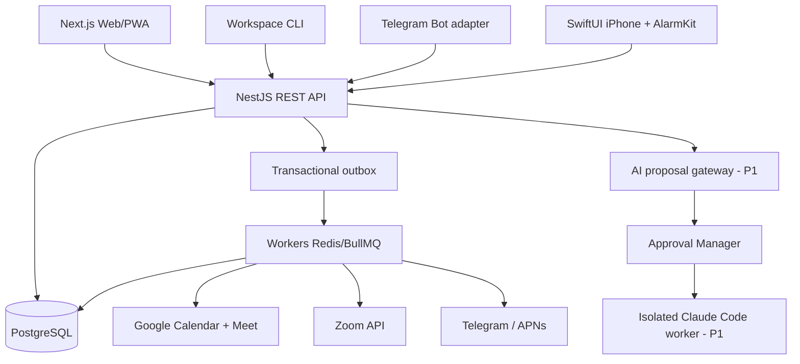

# ARCHITECTURE.md — System Blueprint

## Status dan constraints
Final baseline 2026-10-29, implementasi belum dimulai. Single owner, local Windows -> VPS Ubuntu 4vCPU/8GB RAM. MVP iOS native, Google Meet dan Zoom wajib. Core platform tidak bergantung pada AI. Review dependency terbaru sebelum coding.

## Context diagram (conceptual)

## Runtime layout
- `apps/web`: Next.js route UI, dashboard, PWA. Tidak berisi secrets/OAuth refresh tokens.
- `apps/api`: NestJS modular monolith, owner auth, business services, approvals, OpenAPI, audit.
- `apps/worker`: BullMQ consumers, outbox publisher, reminder dispatcher, integration sync/renewal, retry/reconciliation.
- `apps/cli`: first-party typed API client (bukan alias Claude Code).
- `apps/ios`: SwiftUI, AlarmKit manager, local alarm state, credentials Keychain, device sync + APNs registration.
- `services/coding-agent` (P1): isolated worker, ephemeral repo checkout, least privilege, no production secrets, branch and PR only.
- `packages/contracts`, `database`, `ui`, `config`, `events`, `integrations`, `testing`.

## Domain boundaries
1. `identity`: accounts, MFA, sessions, audit.
2. `project/task`: tasks, subtasks, tags, recurrence.
3. `calendar`: local events, external ownership, conflict detection, sync cursors.
4. `meeting`: provider-aware provisioning, status state machine, join URL.
5. `reminder`: rule/occurrence, schedule, ack, snooze, escalation.
6. `notification`: multi-channel delivery log, retries, quiet hours policy.
7. `device`: iOS alarm scheduling requests/status, APNs tokens and local reconciliation.
8. `integration`: Google/Zoom/Telegram adapters, OAuth, rate limit, webhooks.
9. `workflow` (P1): typed trigger-condition-action graph, approval per side effect.
10. `agent` (P1): proposal, approval, tool registry, agent runs, isolated coding.

## Internal consistency
- DB transactions write entities + outbox atomically; publisher sends to BullMQ; consumer uses idempotency keys and unique indexes. Treat messages as at-least-once.
- External API may commit while local call times out. Use provider id reconciliation instead of blind duplicate retry.
- `calendar_events` tracks external provider event identity/version. Google is authoritative for external source; workspace writes through adapter then reconciles.
- Store UTC instants and IANA timezone; recurrence dates/identity reference local wall time + timezone.
- Device alarm authority is hybrid: server owns intent/rule, iPhone owns scheduling/presentation within AlarmKit authorization. Distinguish `requested`/`scheduled`/`failed`/`acknowledged`; don't infer `presented` if OS doesn't expose it.

## API and cross-platform
REST JSON version `/api/v1`, OAuth2/auth boundaries, OpenAPI-generated TypeScript and Swift clients. Conditional modifications/version checks, `Idempotency-Key`, consistent error envelope. Webhooks separate endpoints with provider signature verification. See `API_CONTRACTS.md`.

## Scaling & deployment
Single VPS Compose first, app/worker/redis/db isolated. DB backups off-host encrypted; monitoring. Docker images built CI. Protect administrative surfaces; public HTTPS only. Agent service added only after P1 security gate. Redis persistence not relied upon as durable schedule authority.

## Explicit non-goals
No Kubernetes, microservices, generalized arbitrary-code plugin execution, unrestricted agent SSH, or built-in LLM for scheduling before P1.

## Decisions
See `ADR.md`, `DECISIONS_AND_BLOCKERS.md`, `IOS_ALARM.md`.
